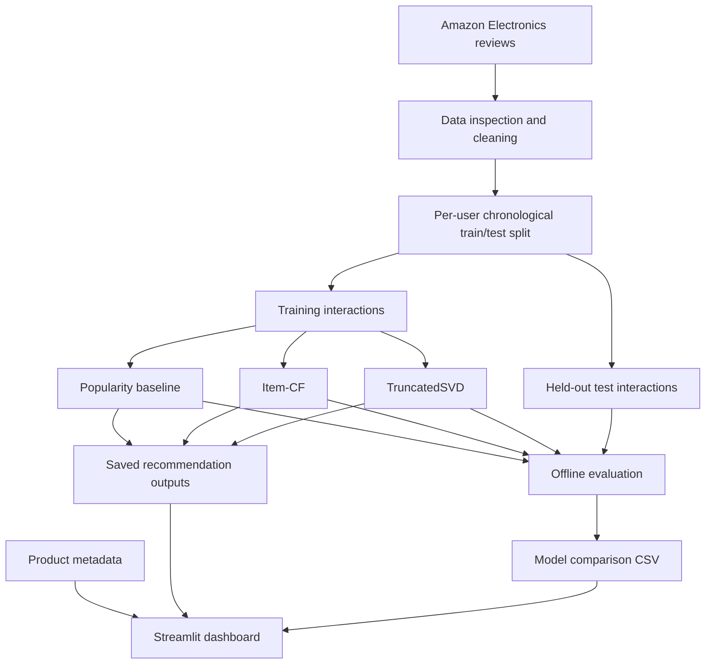
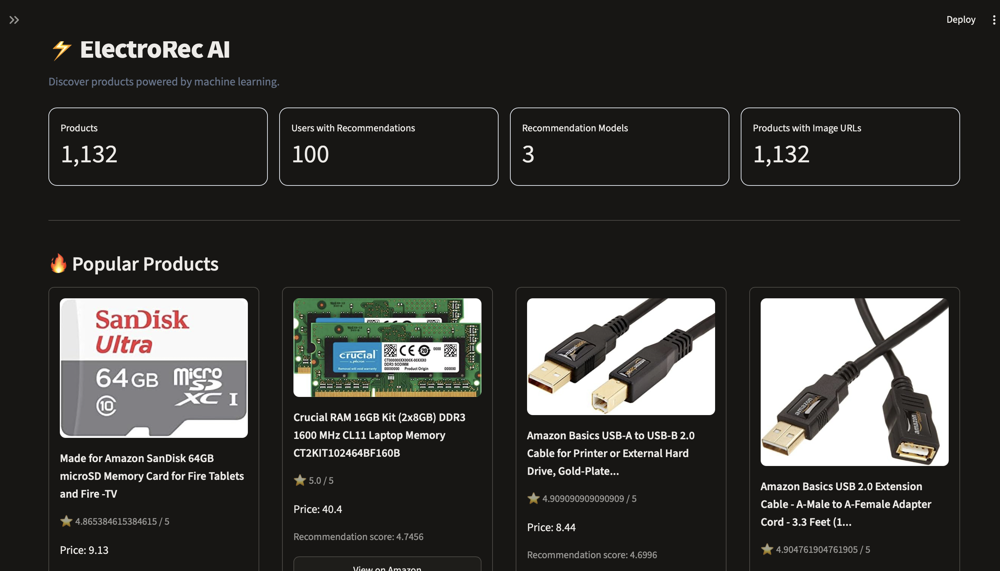
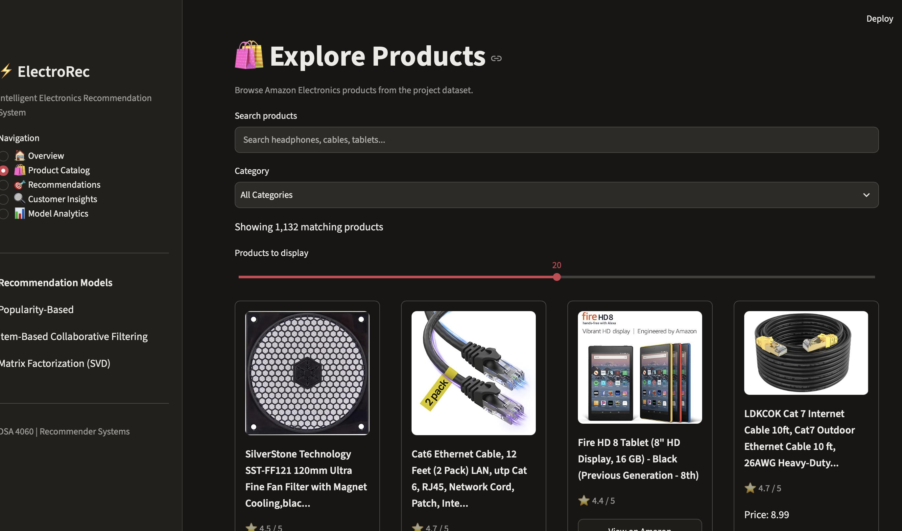
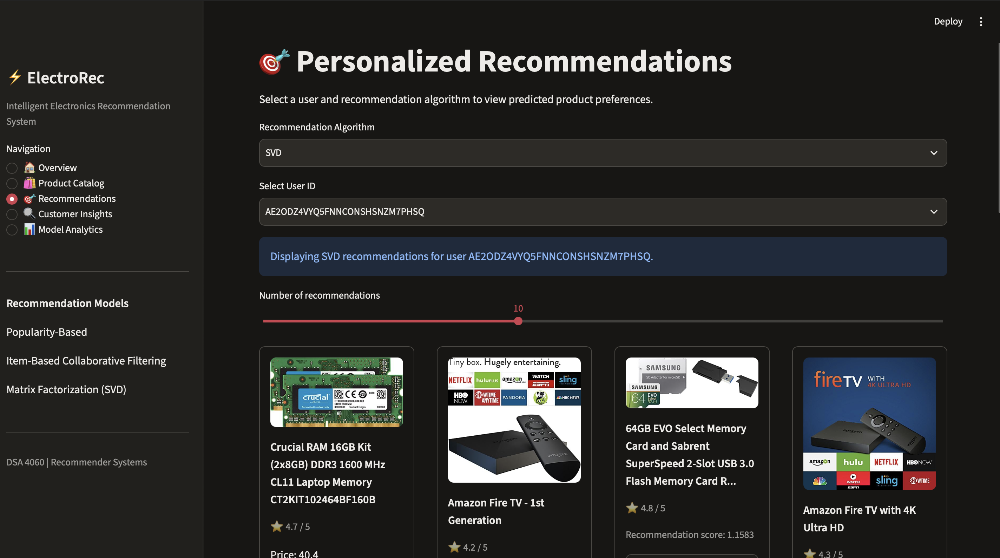
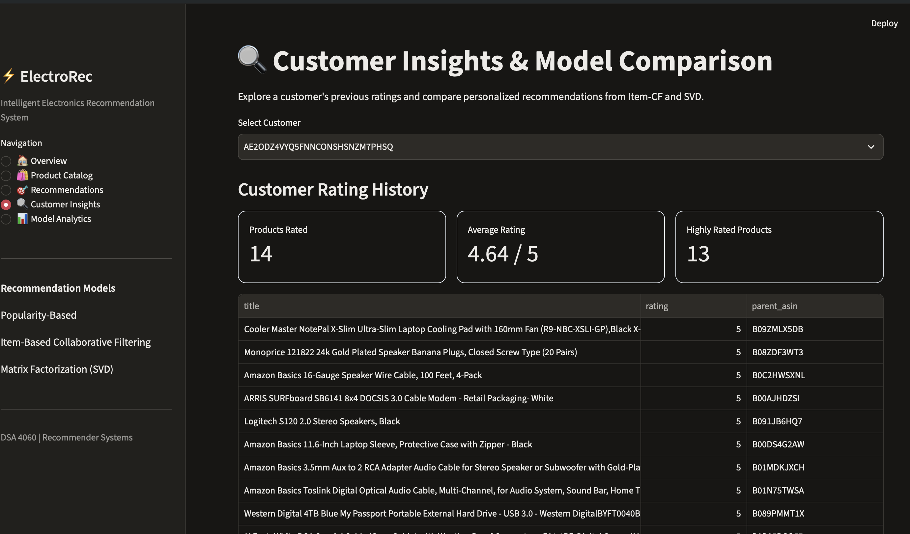
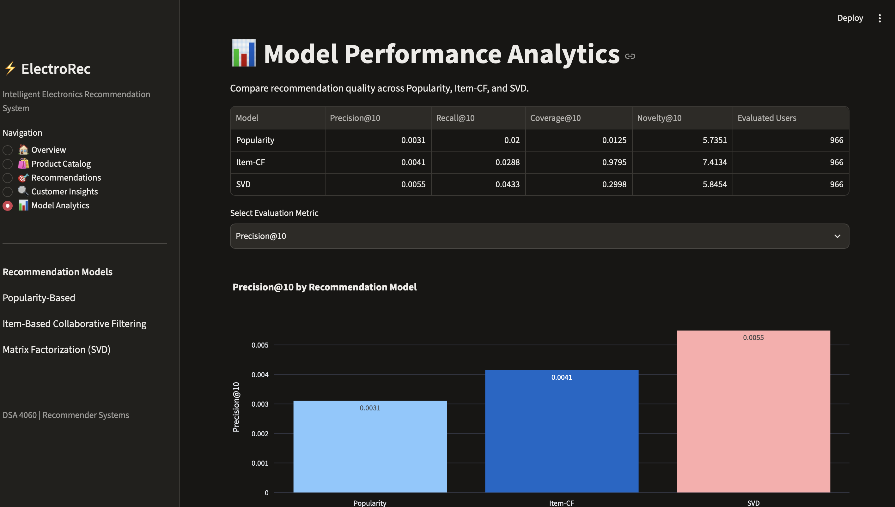

<div align="center">

# ⚡ ElectroRec AI

### An E-Commerce Product Recommendation System

**Popularity-Based Ranking · Item-Based Collaborative Filtering · TruncatedSVD**

An end-to-end academic recommender-system prototype using Amazon Electronics reviews, offline evaluation, product metadata, and an interactive Streamlit dashboard.

**Python · Pandas · NumPy · SciPy · scikit-learn · Streamlit · Plotly**

</div>

---

## Table of Contents

1. [Overview](#1-overview)
2. [Problem Statement and Objectives](#2-problem-statement-and-objectives)
3. [Features](#3-features)
4. [System Architecture](#4-system-architecture)
5. [Dataset](#5-dataset)
6. [Data Preparation and Chronological Split](#6-data-preparation-and-chronological-split)
7. [Recommendation Algorithms](#7-recommendation-algorithms)
8. [Offline Evaluation Methodology](#8-offline-evaluation-methodology)
9. [Results and Discussion](#9-results-and-discussion)
10. [Dashboard Screenshots](#10-dashboard-screenshots)
11. [Technology Stack](#11-technology-stack)
12. [Repository Structure](#12-repository-structure)
13. [Installation and Usage](#13-installation-and-usage)
14. [Reproducing the Experiment](#14-reproducing-the-experiment)
15. [Limitations](#15-limitations)
16. [Future Work](#16-future-work)
17. [Conclusion](#17-conclusion)
18. [Academic Information and References](#18-academic-information-and-references)

---

## 1. Overview

**ElectroRec AI** demonstrates how machine learning can support product discovery in e-commerce. The system uses historical customer ratings to rank electronic products, generate personalized recommendations, and compare recommendation algorithms.

The project implements three approaches:

- **Popularity baseline:** a non-personalized ranking based on aggregate product signals.
- **Item-based collaborative filtering (Item-CF):** personalized recommendations derived from similarities between product rating vectors.
- **Truncated Singular Value Decomposition (SVD):** personalized recommendations from lower-dimensional representations of a sparse user–item matrix.

A **Streamlit** dashboard presents a product catalog, popular products, personalized recommendations, customer rating histories, and model evaluation results. The dashboard loads precomputed recommendation CSVs; it is not a live production recommendation service.

### Scope

The work covers data acquisition and cleaning, exploratory analysis, chronological train/test splitting, model development, offline ranking evaluation, metadata enrichment, and interactive visualization. The experiment uses a sample of **Amazon Reviews 2023 — Electronics**, not the entire Amazon catalog.

## 2. Problem Statement and Objectives

### Problem statement

Large online catalogs make it difficult for customers to find products relevant to their preferences. General popularity rankings help new users but offer limited personalization. Collaborative filtering can identify more tailored suggestions, yet sparse rating histories and cold-start users/products make accurate recommendations difficult. Different models also trade off ranking accuracy, catalog coverage, and novelty.

### General objective

Design, implement, evaluate, and demonstrate a machine-learning-based e-commerce product recommendation system using Amazon Electronics customer ratings.

### Specific objectives

1. Prepare customer–product rating interactions and product metadata.
2. Explore rating behavior and the sparsity of the user–item matrix.
3. Establish a popularity-based recommendation baseline.
4. Implement item-based collaborative filtering using cosine similarity.
5. Implement matrix factorization using `TruncatedSVD`.
6. Evaluate models with Precision@10, Recall@10, Coverage@10, and Novelty@10.
7. Build a dashboard for product exploration, personalized recommendations, customer insights, and model comparison.
8. Interpret model trade-offs and identify improvements.

## 3. Features

| Component | What it does |
|---|---|
| Overview | Shows headline dataset/system statistics and popular products |
| Product Catalog | Lets users explore products and available metadata |
| Personalized Recommendations | Displays ranked suggestions from supported models |
| Customer Insights | Shows a selected customer's rating history and summary information |
| Model Comparison | Compares Item-CF and SVD recommendations for the same customer, including overlap |
| Model Analytics | Visualizes offline evaluation metrics |
| Product Enrichment | Uses matched product titles and image URLs where available |

**Saved personalized outputs:** the Item-CF and SVD generation scripts each produced **1,000 recommendation rows for 100 active users** (up to ten per user). These demonstration outputs are distinct from the larger offline evaluation of 966 eligible users.

## 4. System Architecture



The system separates **offline computation** from **presentation**. Python scripts prepare data, produce recommendation rankings, and calculate evaluation metrics. The dashboard reads the generated files to provide an interactive interface without retraining on every click.

## 5. Dataset

### Source

The project uses a sampled **Amazon Reviews 2023 Electronics** dataset. The collection and accompanying documentation are available at the [Amazon Reviews 2023 project site](https://amazon-reviews-2023.github.io/).

### Dataset summary

| Measure | Value |
|---|---:|
| Cleaned interactions | **10,463** |
| Unique users | **1,166** |
| Unique products | **1,132** |
| Training interactions | **8,678** |
| Test interactions | **1,785** |
| Training users | **1,166** |
| Test users | **1,166** |
| Training products | **1,124** |
| Test products | **696** |
| Test-only products absent from training catalog | **8** |
| Matched product metadata records | **1,132** |
| Users eligible for offline evaluation | **966** |

### Core fields

| Field | Description |
|---|---|
| `user_id` | Customer identifier |
| `parent_asin` | Parent product identifier |
| `rating` | Explicit customer rating |
| `timestamp` | Time of rating interaction |

Product metadata is joined to product identifiers to display names, images, and other available product information. Availability of particular metadata fields varies by product.

### Sparsity

A user–item matrix has **1,166 × 1,132 = 1,319,912** possible cells. Using the cleaned interaction count as an approximation for observed user–product pairs:

$$
\text{Density}\approx\frac{10,463}{1,166\times1,132}\approx0.00793
$$

$$
\text{Sparsity}\approx 1-0.00793=99.21\%
$$

This approximation assumes one distinct observed user–product pair per counted interaction. Repeated ratings for the same pair would change the exact density. The high sparsity motivates sparse matrices and latent-factor methods.

## 6. Data Preparation and Chronological Split

### Preparation workflow

1. Load the sampled reviews and inspect fields, rating distributions, and identifiers.
2. Clean the interaction records and retain the fields required by the models.
3. Prepare numeric user and product indices for sparse matrix construction.
4. Split each user's interactions chronologically into training and testing data.
5. Fit recommendation models on **training data only**.
6. Use held-out test interactions for offline evaluation.

### Per-user chronological split

The split procedure in `src/06_train_test_split.py` sorts interactions by **`user_id`, `timestamp`, and `parent_asin`**. For each user, earlier interactions go to training and the latest interactions go to testing.

The test allocation follows:

```python
test_count = max(1, int(0.20 * user_count))
```

This reserves at least one test interaction per user and approximately the last 20% of their interactions, subject to integer truncation. The resulting aggregate proportions are not exactly 80/20:

| Partition | Interactions | Share of cleaned data |
|---|---:|---:|
| Training | 8,678 | 82.94% |
| Test | 1,785 | 17.06% |
| **Total** | **10,463** | **100%** |

**Why chronological?** This design tests whether historical customer behavior can help rank products encountered later. It avoids using a user's later ratings as inputs when generating recommendations for that user's earlier point in time.

**Catalog constraint:** eight products occur only in the test partition and are absent from the training catalog. Models that rank only products known during training cannot recommend those eight products. The evaluation therefore restricts relevant test candidates to the training product catalog.

### Sparse user–item representation

The training ratings are represented by a sparse matrix:

$$
R\in\mathbb{R}^{m\times n},\qquad R_{ui}=\text{observed rating of user }u\text{ for item }i
$$

Unobserved entries are stored as implicit zeros in the sparse representation; these are **missing interactions**, not observed zero-star ratings. SciPy sparse matrices reduce memory use relative to dense matrices.

## 7. Recommendation Algorithms

### 7.1 Popularity-based baseline

The popularity baseline ranks products using aggregate rating/popularity information rather than individual user histories. It provides a simple reference for judging whether personalization improves results.

**Strengths:** simple, interpretable, and useful when a user has no rating history. **Weaknesses:** limited personalization, concentration on popular products, and potentially low catalog coverage.

Implementation: `src/04_popularity_baseline.py`. The exact aggregate ranking rule is defined in that source file; this README does not substitute an unverified scoring formula.

### 7.2 Item-based collaborative filtering

Item-CF identifies products with similar rating patterns across users.

**Step 1 — Item vectors.** Represent each product by its ratings across users in the training matrix.

**Step 2 — Cosine similarity.** For products $i$ and $j$:

$$
\operatorname{sim}(i,j)=\frac{\mathbf r_i\cdot\mathbf r_j}{\lVert\mathbf r_i\rVert\lVert\mathbf r_j\rVert}
$$

**Step 3 — Positive user history.** The recommendation-generation implementation uses products rated **at least four stars** as positive preference signals.

**Step 4 — Candidate ranking.** The model aggregates item similarities weighted by positive rating values. Conceptually:

$$
\operatorname{score}(u,j)=\sum_{i\in L_u}\operatorname{sim}(j,i)\,r_{ui}
$$

where $L_u$ is the set of positively rated products for user $u$. These are **ranking scores**, not calibrated purchase probabilities.

**Step 5 — Exclusion.** Previously rated products are removed from the candidate list. Candidates without positive similarity evidence are excluded.

**Step 6 — Output.** Rank remaining products by score and save up to ten recommendations per selected user.

**Strengths:** personalization and product discovery using item relationships. **Weaknesses:** sparse overlap, item cold-start, and potentially costly similarity computations at scale.

Implementation: `src/05_collaborative_filtering.py`.

### 7.3 Matrix factorization with TruncatedSVD

TruncatedSVD compresses the user–item matrix into a lower-dimensional representation. A rank-$k$ approximation is:

$$
R\approx U_k\Sigma_kV_k^T
$$

where $k$ is the number of retained latent dimensions.

The project uses **30 components** and a fixed random seed for reproducibility. The implementation reconstructs approximate preference scores from the user and item representations, excludes already-rated products, and ranks unseen products.

Illustrative structure:

```python
from sklearn.decomposition import TruncatedSVD

svd = TruncatedSVD(n_components=30, random_state=42)
user_factors = svd.fit_transform(train_matrix)
item_factors = svd.components_.T
scores = user_factors @ item_factors.T
```

This is **TruncatedSVD on a sparse rating matrix**, not an explicit-feedback matrix factorization method trained with a masked loss over observed entries only. Consequently, unobserved matrix entries influence the factorization through their zero representation.

**Strengths:** captures latent associations and generates personalized rankings. **Weaknesses:** factors are hard to interpret, sparse data can affect quality, and cold-start users require another strategy.

Implementation: `src/07_matrix_factorization.py`.

### Algorithm comparison

| Property | Popularity | Item-CF | TruncatedSVD |
|---|---|---|---|
| Personalized | No | Yes | Yes |
| Primary signal | Aggregate product ratings | Item rating-vector similarity | Latent user–item factors |
| Needs user history | No | Yes | Yes |
| Supports new users without history | As fallback | Not directly | Not directly |
| Main trade-off | Concentration on popular items | Sparse item overlap | Less interpretable latent scores |

**Important:** Item-CF scores and SVD scores use different scales and should not be compared numerically as if they were equivalent probabilities or predicted ratings.

## 8. Offline Evaluation Methodology

The evaluation is implemented in `src/08_evaluate_models.py` and writes `results/model_comparison.csv`.

### Evaluation protocol

1. Build the models from the **training partition only**.
2. Treat test interactions with **rating ≥ 4** as relevant.
3. Exclude products already present in each user's training history from recommendations.
4. Restrict relevant held-out products to those present in the **training product catalog**; test-only products cannot be retrieved by these models.
5. Evaluate users with **at least one eligible relevant test product**.
6. Generate top-10 ranked recommendations for each eligible user and compute the evaluation metrics.

**Eligible evaluated users: 966.** This count is distinct from the 100 active users whose recommendations were exported for dashboard demonstration.

### Precision@10

The proportion of the top ten recommendations that are relevant:

$$
\operatorname{Precision@10}(u)=\frac{|\operatorname{Rec}_{10}(u)\cap\operatorname{Rel}(u)|}{10}
$$

### Recall@10

The proportion of eligible relevant held-out products recovered by the top ten:

$$
\operatorname{Recall@10}(u)=\frac{|\operatorname{Rec}_{10}(u)\cap\operatorname{Rel}(u)|}{|\operatorname{Rel}(u)|}
$$

### Coverage@10

The fraction of the eligible training product catalog appearing across recommendation lists:

$$
\operatorname{Coverage@10}=\frac{|\bigcup_u\operatorname{Rec}_{10}(u)|}{|\mathcal I_{\mathrm{train}}|}
$$

### Novelty@10

Novelty describes how uncommon recommended items are under a popularity-based scoring function. A common form is self-information:

$$
\operatorname{Novelty}(i)=-\log_2 P(i)
$$

The reported novelty values come from the **project's evaluation script**; the precise popularity estimate and any smoothing should be taken from that implementation rather than assumed from the generic formula above.

### Interpretation cautions

- These are **offline, held-out-interaction metrics**, not live click-through or conversion rates.
- The test set is a sample of observed future ratings, not a complete record of everything each customer would like.
- The small number of relevant test items per user and the sparse catalog can produce low absolute Precision@10 and Recall@10.
- Comparison with published benchmarks requires matching dataset, split, relevance, candidate pool, and metric definitions.

## 9. Results and Discussion

### Verified model comparison

| Model | Precision@10 | Recall@10 | Coverage@10 | Novelty@10 | Evaluated users |
|---|---:|---:|---:|---:|---:|
| Popularity | 0.003106 | 0.020031 | 0.012456 | 5.735097 | 966 |
| Item-CF | 0.004141 | 0.028755 | **0.979537** | **7.413434** | 966 |
| TruncatedSVD | **0.005487** | **0.043254** | 0.299822 | 5.845356 | 966 |

Source: output of `python src/08_evaluate_models.py`, saved to `results/model_comparison.csv`.

### 9.1 Ranking relevance

**TruncatedSVD performed best on Precision@10 and Recall@10.** It recovered more eligible held-out relevant products than the other two approaches under this evaluation. Item-CF ranked second, while Popularity provided the baseline.

All three models nevertheless have **low absolute ranking metrics**. For example, SVD's Precision@10 of 0.005487 corresponds to roughly 0.55% of the ten recommendation positions matching eligible relevant held-out products on average. This should not be presented as production-ready recommendation accuracy.

### 9.2 Catalog coverage

**Item-CF achieved 0.979537 Coverage@10 (approximately 97.95%).** In contrast, SVD covered approximately 29.98% and Popularity approximately 1.25% of the eligible catalog.

This suggests Item-CF spread its recommendations across substantially more products, whereas the popularity baseline repeatedly selected a small subset of highly ranked items. Coverage measures breadth of exposure, not whether every exposed item is relevant.

### 9.3 Novelty

**Item-CF achieved the highest Novelty@10 (7.413434)** under the project's metric. Its recommendations were relatively less popular than those of the other models according to that calculation. Novelty may support discovery, but it does not independently establish satisfaction or accuracy.

### 9.4 Trade-offs

| Objective | Strongest observed model |
|---|---|
| Precision@10 | TruncatedSVD |
| Recall@10 | TruncatedSVD |
| Coverage@10 | Item-CF |
| Novelty@10 | Item-CF |

**Conclusion from the experiment:** no model dominated every metric. TruncatedSVD was strongest for measured ranking relevance; Item-CF was strongest for breadth and novelty. The popularity baseline remains useful as a simple non-personalized fallback.

### 9.5 Recommendation overlap

The dashboard also compares Item-CF and SVD recommendation lists for an individual customer. For two top-$K$ lists, one simple overlap measure is:

$$
\operatorname{Overlap@K}=\frac{|\operatorname{Rec}^{\mathrm{ItemCF}}_K(u)\cap\operatorname{Rec}^{\mathrm{SVD}}_K(u)|}{K}
$$

A low overlap indicates different selected products; it does **not** prove that one model is more accurate. Unlike the aggregate evaluation table, overlap is a customer-level comparison of list agreement.

## 10. Dashboard Screenshots

All screenshots below are captures of the project's Streamlit interface and are stored in the repository's `screenshots/` folder.

### 10.1 Overview



The overview presents high-level project statistics and popular products, helping viewers understand the dataset and the application's purpose.

### 10.2 Product Catalog



The catalog makes the dataset browsable through product cards and available metadata, including product images and titles.

### 10.3 Personalized Recommendations



This view displays ranked recommendations for supported customers and algorithms. Recommendation scores are model-specific and primarily useful for ordering products within a model.

### 10.4 Customer Insights



Customer Insights provides context about a selected user's historical ratings and helps explain which observations are available to the personalized models.

### 10.5 Model Comparison



The model comparison view presents Item-CF and SVD suggestions side by side and highlights differences in recommended products. The application also includes a Model Analytics section for aggregate evaluation metrics; a separate sixth screenshot is not required.

## 11. Technology Stack

| Tool | Use |
|---|---|
| Python | Data preparation, modeling, evaluation, and dashboard logic |
| Pandas | Tabular data processing and CSV outputs |
| NumPy | Numerical operations |
| SciPy | Sparse matrices |
| scikit-learn | Cosine similarity and TruncatedSVD |
| Streamlit | Interactive web dashboard |
| Plotly | Evaluation and dashboard charts |
| Pillow | Image support |
| Requests | HTTP requests used in data/metadata workflows |
| Git and GitHub | Version control and project publication |

Dependencies are listed in `requirements.txt`.

## 12. Repository Structure

```text
DSA4060XA-Ecommerce-Recommender/
├── dashboard/
│   └── app.py
├── data/
│   ├── cleaned/
│   │   ├── electronics_cleaned.csv
│   │   ├── train.csv
│   │   ├── test.csv
│   │   └── product_metadata.csv
│   └── raw/                  # ignored; raw download artifacts
├── results/
│   ├── popularity_rankings.csv
│   ├── collaborative_recommendations.csv
│   ├── svd_recommendations.csv
│   └── model_comparison.csv
├── screenshots/
│   ├── 01_overview.png
│   ├── 02_product_catalog.png
│   ├── 03_recommendations.png
│   ├── 04_customer_insights.png
│   └── 05_model_comparison.png
├── src/
│   ├── 01_download_data.py
│   ├── 02_data_understanding.py
│   ├── 03_clean_data.py
│   ├── 04_popularity_baseline.py
│   ├── 05_collaborative_filtering.py
│   ├── 06_train_test_split.py
│   ├── 07_matrix_factorization.py
│   ├── 08_evaluate_models.py
│   ├── 09_fetch_product_metadata.py
│   └── recommender.py
├── .gitignore
├── requirements.txt
└── README.md
```

### Script responsibilities

| Script | Purpose |
|---|---|
| `01_download_data.py` | Obtain the dataset sample |
| `02_data_understanding.py` | Inspect data characteristics |
| `03_clean_data.py` | Clean and prepare rating interactions |
| `04_popularity_baseline.py` | Generate non-personalized popularity rankings |
| `05_collaborative_filtering.py` | Generate item-based collaborative recommendations |
| `06_train_test_split.py` | Perform per-user chronological train/test split |
| `07_matrix_factorization.py` | Fit TruncatedSVD and save personalized rankings |
| `08_evaluate_models.py` | Compute offline model comparison metrics |
| `09_fetch_product_metadata.py` | Retrieve and match product metadata |
| `recommender.py` | Supporting recommendation logic |
| `dashboard/app.py` | Run the interactive dashboard |

## 13. Installation and Usage

### Prerequisites

- Python 3 and `pip`
- Git (for cloning)
- Internet access if loading remotely hosted product images

### Clone the repository

Once the repository is published, replace the placeholder below with its real URL:

```bash
git clone https://github.com/YOUR_USERNAME/DSA4060XA-Ecommerce-Recommender.git
cd DSA4060XA-Ecommerce-Recommender
```

### Create and activate a virtual environment

**macOS / Linux:**

```bash
python3 -m venv .venv
source .venv/bin/activate
```

**Windows PowerShell:**

```powershell
python -m venv .venv
.venv\Scripts\Activate.ps1
```

### Install dependencies

```bash
python -m pip install -r requirements.txt
```

### Launch the dashboard

```bash
python -m streamlit run dashboard/app.py
```

Open the local URL printed by Streamlit, typically **http://localhost:8501**. Use the navigation to explore the Overview, Product Catalog, Personalized Recommendations, Customer Insights, and Model Analytics pages.

**Stop the server:** return to the terminal and press **Ctrl+C**.

### Using the published project

The repository includes cleaned CSVs and saved model outputs for dashboard demonstration. If those files are present, it is not necessary to rerun the entire data-processing pipeline merely to explore the dashboard.

## 14. Reproducing the Experiment

### Generate or refresh model outputs

Run from the repository root with the virtual environment active:

```bash
python src/04_popularity_baseline.py
python src/05_collaborative_filtering.py
python src/07_matrix_factorization.py
python src/08_evaluate_models.py
```

The evaluation output is saved to `results/model_comparison.csv`. The dashboard consumes the generated results.

### Full data workflow

The source scripts are organized as follows:

```text
Download → Understand → Clean → Chronological Split
         → Generate Recommendations → Evaluate
         → Enrich Product Metadata → Dashboard
```

The existing processed files allow the project to be inspected without redownloading raw data. Full reproduction from the original source may depend on network access, source-data availability, and the data-download script's settings.

### Reproducibility checklist

- [ ] Install dependencies from `requirements.txt`.
- [ ] Confirm cleaned, training, and testing CSVs exist.
- [ ] Use the per-user chronological split in `06_train_test_split.py`.
- [ ] Fit models on training interactions only.
- [ ] Use ratings **≥ 4** as relevant held-out interactions.
- [ ] Exclude previously seen products and test-only products outside the training catalog.
- [ ] Evaluate the **966 eligible users** with top-10 rankings.
- [ ] Compare regenerated metrics with `results/model_comparison.csv`.
- [ ] Launch the Streamlit dashboard and inspect the five documented views.

**Methodological note:** This README describes the split and evaluation procedures previously established for the project. For exact implementation details (such as the popularity score formula, novelty smoothing, and tie handling), the source scripts remain authoritative.

## 15. Limitations

1. **High sparsity:** most user–product pairs have no observed ratings, making preference estimation difficult.
2. **Cold start:** new users and products may lack the interaction history required for personalized collaborative filtering.
3. **Sampled catalog:** results are based on a sample of Electronics reviews and may not generalize to the full catalog.
4. **Low absolute ranking metrics:** observed Precision@10 and Recall@10 indicate substantial room for improvement.
5. **Explicit feedback focus:** ratings do not capture all behavioral signals, such as clicks, cart additions, and purchases.
6. **Precomputed outputs:** the dashboard is a demonstration interface, not a continuously updating production recommender.
7. **Catalog eligibility:** test-only products absent from the training catalog cannot be recommended by these models.
8. **Latent-factor interpretation:** SVD dimensions do not provide straightforward human-readable explanations.
9. **External images:** product cards may depend on third-party image URLs remaining available.

## 16. Future Work

- **Hybrid recommendations:** combine collaborative signals with product titles, descriptions, and categories.
- **Cold-start fallbacks:** use popularity and content-based ranking for new users/products.
- **Implicit feedback:** include clicks, saves, purchases, and browsing behavior.
- **Hyperparameter tuning:** evaluate alternative SVD dimensions, similarity choices, and candidate-ranking rules.
- **Additional metrics:** measure NDCG@K, diversity, serendipity, and calibration.
- **More robust validation:** evaluate across multiple time windows and larger datasets.
- **Explainability:** provide evidence-backed reasons for individual recommendations.
- **Live serving:** expose model predictions through a backend service instead of relying only on precomputed CSVs.
- **Scalability:** test approximate nearest-neighbor search and larger sparse matrices.

## 17. Conclusion

ElectroRec AI combines data preparation, chronological offline evaluation, three recommendation approaches, and a working Streamlit interface in one academic project.

The evaluation shows a meaningful trade-off: **TruncatedSVD** achieved the strongest measured **Precision@10 and Recall@10**, while **Item-CF** achieved the strongest **Coverage@10 and Novelty@10**. The popularity baseline provides a useful non-personalized comparison.

The project demonstrates the practical workflow of building and analyzing recommender systems while making clear that sparse data, cold-start problems, and low absolute ranking metrics remain important challenges.

## 18. Academic Information and References

### Academic information

| Field | Detail |
|---|---|
| Project | ElectroRec AI — E-Commerce Product Recommendation System |
| Course | DSA 4060 — Recommender Systems |
| Institution | United States International University–Africa (USIU–Africa) |
| Programme | BSc Data Science and Analytics |
| Domain | E-Commerce / Machine Learning |
| Interface | Streamlit |

### References

1. Amazon Reviews 2023. [Dataset and documentation](https://amazon-reviews-2023.github.io/).
2. Hou, Y., Li, J., He, Z., Yan, A., Chen, X., & McAuley, J. (2024). *Bridging language and items for retrieval and recommendation*. Proceedings of EMNLP 2024. (Associated Amazon Reviews 2023 dataset publication.)
3. Sarwar, B., Karypis, G., Konstan, J., & Riedl, J. (2001). [Item-based collaborative filtering recommendation algorithms](https://doi.org/10.1145/371920.372071). *Proceedings of the 10th International Conference on World Wide Web*, 285–295.
4. Koren, Y., Bell, R., & Volinsky, C. (2009). [Matrix factorization techniques for recommender systems](https://doi.org/10.1109/MC.2009.263). *Computer, 42*(8), 30–37.
5. [scikit-learn documentation](https://scikit-learn.org/stable/modules/generated/sklearn.decomposition.TruncatedSVD.html).
6. [SciPy sparse matrix documentation](https://docs.scipy.org/doc/scipy/reference/sparse.html).
7. [Streamlit documentation](https://docs.streamlit.io/).

---

<div align="center">

**⚡ ElectroRec AI — Intelligent Product Discovery Through Machine Learning**

*Developed for academic and educational purposes.*

</div>
